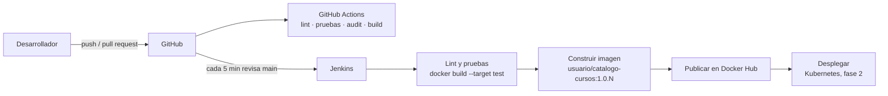

# Catálogo de cursos: laboratorio de CI/CD

App web de ejemplo (Node.js + Express) para practicar integración y entrega continua en el curso Fundamentos DevOps. La app es intencionalmente pequeña: el foco está en los pipelines.

- **CI con GitHub Actions** (`.github/workflows/ci.yml`): corre en cada push y pull request.
- **CD con Jenkins** (`Jenkinsfile`): clona, prueba, construye la imagen Docker y la publica en Docker Hub.
- **Jenkins como código** (`jenkins/`): Docker + Configuration as Code (JCasC). Cualquier persona lo levanta igual en su equipo.

## Flujo CI/CD



| Etapa | Dónde | Qué hace |
| --- | --- | --- |
| Checkout | Actions y Jenkins | Descarga el código del commit que se va a probar. |
| Instalar dependencias | Actions (`npm ci`) y Jenkins (Dockerfile, etapa `test`) | Instala exactamente las versiones de `package-lock.json`. |
| Análisis estático | ESLint | Detecta errores y malas prácticas antes de ejecutar el código. |
| Pruebas | `node --test` | Prueba los endpoints `/health` y `/api/cursos`. |
| Auditoría de dependencias | `npm audit` (Actions) | Avisa de vulnerabilidades altas o críticas en las librerías. |
| Imagen Docker | Jenkins | Construye la imagen final, sin dependencias de desarrollo y sin root. |
| Publicación | Jenkins → Docker Hub | Sube la imagen con su versión (`1.0.<build>`) y `latest`. Solo desde `main`. |

## Correr la app en tu equipo

```bash
npm ci
npm test         # pruebas
npm run lint     # análisis estático
npm start        # http://localhost:3000
```

Con Docker:

```bash
docker build -t catalogo-cursos .
docker run -p 3000:3000 catalogo-cursos
```

## Levantar Jenkins (práctica local)

Requisitos: Docker Desktop encendido y una cuenta de Docker Hub con un token de acceso.

1. Copia `jenkins/.env.example` como `jenkins/.env` y llena los valores. **El `.env` no se sube a Git.**
2. Desde la carpeta `jenkins/`:

   ```bash
   docker compose up -d --build
   ```

3. Entra a <http://localhost:8080> con el usuario `admin` y la clave que pusiste en `.env`.
4. El job `catalogo-cursos-cd` ya está creado. Ejecútalo con **Build Now**; después, Jenkins revisa `main` cada 5 minutos.

Para apagarlo: `docker compose down`. Para borrar también su historial: `docker compose down -v`.

## Seguridad

- No hay secretos en el repositorio. La clave de Jenkins y el token de Docker Hub viven en `jenkins/.env`, que está en `.gitignore`.
- En Jenkins, el token se usa con `withCredentials`, así que aparece enmascarado en los registros.
- La imagen final corre con el usuario `node`, no con root.
- Jenkins tiene acceso al Docker del equipo (socket montado) para construir imágenes. Es práctico para un laboratorio local, pero en un servidor real conviene usar agentes aparte.

## Próximas fases

1. **Despliegue:** manifiestos de Kubernetes y la etapa `Desplegar` del Jenkinsfile aplicándolos al clúster.
2. **Seguridad:** escaneo de la imagen (por ejemplo, Trivy) y de secretos (Gitleaks) en el pipeline.
3. **Monitoreo:** métricas y alertas sobre el endpoint `/health`.

## Evidencias

Las capturas de los pipelines en ejecución van en `docs/capturas/` (GitHub Actions y Jenkins).
