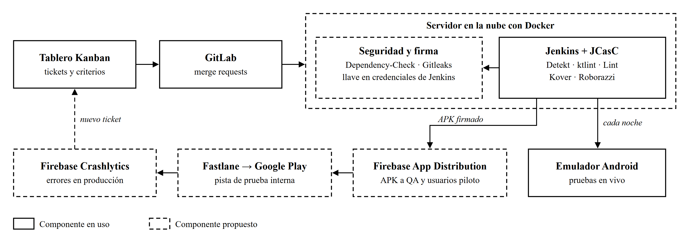
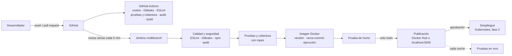
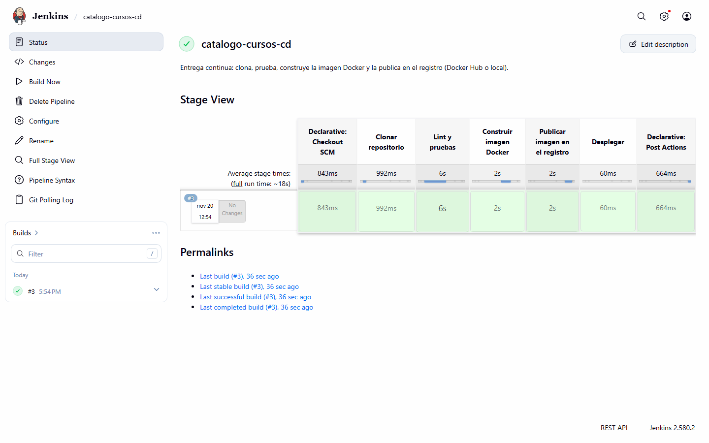
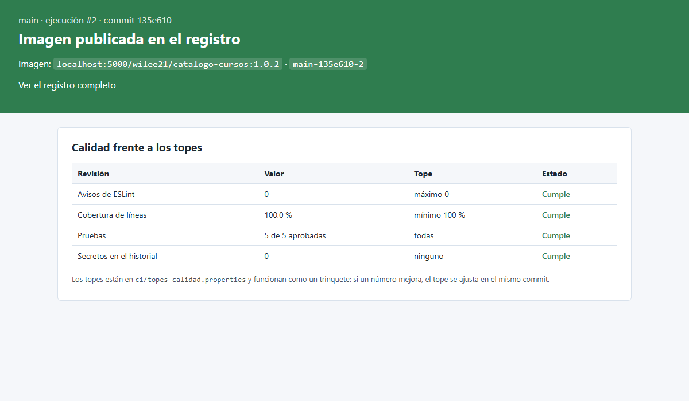
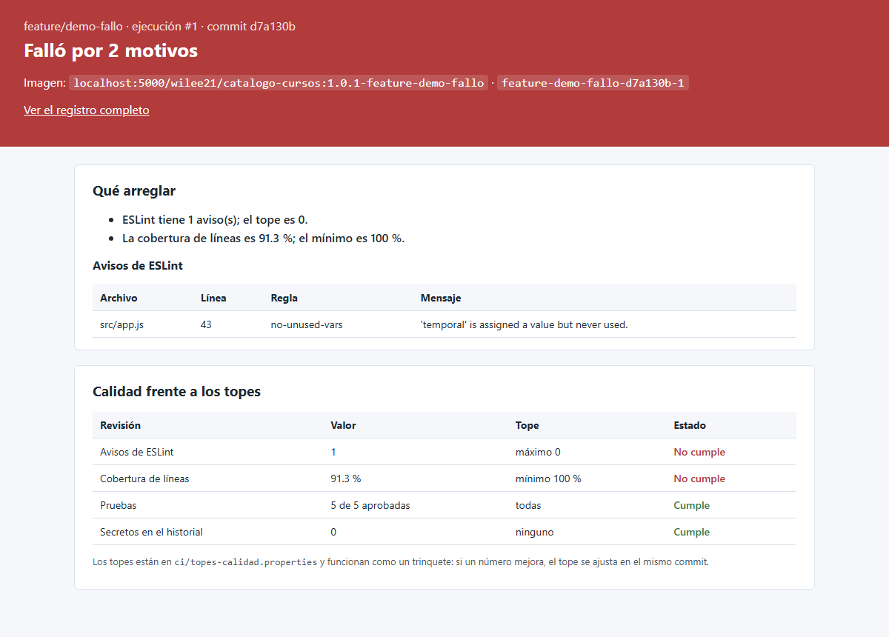
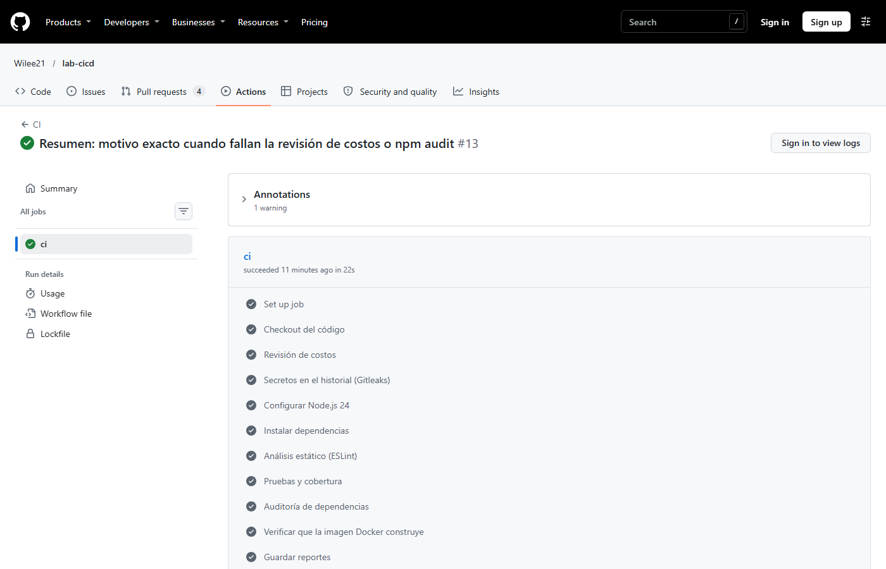

# Catálogo de cursos: laboratorio de CI/CD

Aplicación web de referencia (Node.js y Express) desarrollada para implementar prácticas de integración y entrega continua en el curso Fundamentos DevOps. El alcance funcional de la aplicación se limita deliberadamente, ya que el objeto del laboratorio son los pipelines.

- **Integración continua con GitHub Actions** (`.github/workflows/ci.yml`): se ejecuta en cada push y en cada pull request.
- **CI/CD por rama con Jenkins** (`Jenkinsfile`, job multibranch): revisión de costos, calidad y seguridad en paralelo, pruebas con cobertura mínima, construcción de la imagen, prueba de humo y, en `main`, publicación en un registro de imágenes.
- **Pruebas en vivo cada noche** (`ci/PruebasEnVivo.Jenkinsfile`): prueban la última imagen publicada.
- **Jenkins como código** (`jenkins/`): Docker y Jenkins Configuration as Code (JCasC), con secretos fuera del repositorio y avisos de Windows.

## Contexto en el proyecto del curso

Este repositorio corresponde a la primera fase del proyecto de Fundamentos DevOps: la estructura de los pipelines de CI/CD. Las fases siguientes agregan el despliegue en Kubernetes con controles de seguridad adicionales y, posteriormente, el monitoreo.

La implementación parte de la arquitectura de herramientas DevOps diseñada en la Actividad 2 del curso (trabajo grupal) para la aplicación móvil de una plataforma educativa. Esa propuesta identificó cinco brechas en el ciclo de entrega y definió una arquitectura basada en Jenkins con JCasC, topes de calidad, controles de seguridad (OWASP Dependency-Check y Gitleaks), credenciales gestionadas fuera del repositorio, pruebas nocturnas, monitoreo y trazabilidad entre commit, compilación y versión. Dado que el proyecto del curso requiere una aplicación web desplegable en Kubernetes, este repositorio aplica esos mismos mecanismos sobre un servicio web de referencia del mismo dominio, sin código ni datos de la organización.



La correspondencia entre cada componente de la propuesta y su implementación se encuentra en la [documentación técnica](docs/documentacion-tecnica.md#22-correspondencia-con-el-laboratorio).

## Flujo de CI/CD



| Stage de Jenkins | Descripción | Frena la ejecución si… |
| --- | --- | --- |
| Revisar costos | `ci/revisar-costos.sh`: plugins aprobados, sin agentes en la nube, Jenkins solo en `127.0.0.1`, imágenes base esperadas. | Aparece algo que pueda generar costos o exponer Jenkins. |
| Instalar dependencias | `npm ci` en un contenedor de Node.js 24 (`ci/en-node.sh`). | Falla la instalación. |
| ESLint | Reporte JSON convertido al formato de Warnings Next Generation (`ci/eslint-a-issues.js`). | Hay más avisos que el tope o **un solo aviso nuevo** frente a `main`. |
| Secretos (Gitleaks) | Revisa todo el historial de Git (`ci/gitleaks.sh`). | Encuentra cualquier secreto. |
| Dependencias (npm audit) | Dependencias de producción. | Hay vulnerabilidades altas o críticas. |
| Pruebas y cobertura | `node:test` con reportes JUnit y LCOV; `ci/revisar-cobertura.js` compara con el tope. | Falla una prueba o la cobertura baja del mínimo. |
| Construir imagen Docker | Imagen con versión, commit y etiquetas OCI. | Falla la construcción. |
| Prueba de humo | Arranca la imagen y verifica `/health` (versión y commit) y `/api/cursos`. | La imagen no responde como se espera. |
| Publicar imagen en el registro | Solo `main`: `1.0.<n>`, `<rama>-<commit>-<n>` y `latest`. | Falla la publicación. |
| Desplegar | Solo `main` con el parámetro `DESPLEGAR`: pide aprobación explícita (`input`). | No se aprueba. |

## Topes de calidad

Los topes están en [`ci/topes-calidad.properties`](ci/topes-calidad.properties) y los aplican tanto Jenkins como GitHub Actions. Funcionan como un **trinquete**: la ejecución falla si un número empeora; cuando un cambio lo mejora, en el mismo commit se ajusta el tope al valor nuevo para que no vuelva a empeorar. Un tope solo se relaja por acuerdo del equipo.

| Revisión | Tope actual | La ejecución falla con |
| --- | --- | --- |
| Avisos de ESLint | 0 | 1 aviso o más, o cualquier aviso nuevo frente a `main` |
| Cobertura de líneas de `src/` | 100 % | menos del 100 % |
| Secretos (Gitleaks) | 0 | cualquier hallazgo |

Además de los totales, cada rama se compara con la última ejecución de `main` (`discoverReferenceBuild`): un aviso cuenta como **nuevo** si su línea es nueva o cambió. Así nadie hereda avisos anteriores, pero tampoco puede sumar otros.

## Página Resumen y trazabilidad

Cada ejecución de Jenkins publica la pestaña **Resumen** (`ci/resumen/generar.js`): el veredicto como titular ("Se puede integrar a main", "Imagen publicada en el registro" o "Falló por N motivos"), la lista de qué arreglar (avisos uno por uno, pruebas fallidas, cobertura y secretos) y la tabla de calidad frente a los topes. La lista de ejecuciones muestra una línea por ejecución, por ejemplo `4284927 · Imagen publicada en el registro · 5 pruebas · 100,0 %`.

La trazabilidad entre commit, compilación y versión se mantiene en tres lugares: las etiquetas de la imagen (`1.0.<n>` y `<rama>-<commit>-<n>`), las etiquetas OCI (`org.opencontainers.image.revision` y `version`, visibles con `docker inspect`) y el endpoint `/health`, que responde con la versión y el commit de la imagen en ejecución.

## Pruebas en vivo (cada noche)

El job `pruebas-en-vivo` se ejecuta cada noche (`H 2 * * *`) y a demanda. No prueba el código del repositorio, sino la **imagen ya publicada**: la descarga del registro, la arranca y ejecuta contra ella las pruebas de `test/en-vivo/` (disponibilidad y versión, contenido del catálogo y respuesta 404). Detecta problemas que solo aparecen en el artefacto final, como una imagen incompleta o un error al arrancar.

## Estructura del repositorio

| Ruta | Contenido |
| --- | --- |
| `src/` | Código fuente de la API (Express). |
| `test/` | Pruebas de integración de los endpoints; `test/en-vivo/`, pruebas contra el servicio desplegado. |
| `.github/workflows/ci.yml` | Pipeline de integración continua (GitHub Actions). |
| `.github/` | Dependabot, plantilla de historia de usuario con criterios de aceptación y plantilla de pull request. |
| `Jenkinsfile` | Pipeline de CI/CD por rama (Jenkins multibranch). |
| `ci/` | Scripts de los pipelines: revisión de costos, topes, Gitleaks, cobertura, página Resumen y pruebas en vivo. |
| `Dockerfile` | Imagen multietapa: etapa `test` para validación y etapa `runtime` para la imagen final. |
| `jenkins/` | Jenkins como código (imagen, plugins, JCasC, Docker Compose), secretos y avisos de Windows. |
| `docs/` | Documentación técnica y evidencias de ejecución. |

## Ejecución local de la aplicación

Requiere Node.js 24.

```bash
npm ci
npm test                 # pruebas
npm run test:cobertura   # pruebas con reportes JUnit y LCOV en reportes/
npm run lint             # análisis estático
npm start                # http://localhost:3000
```

Con Docker:

```bash
docker build -t catalogo-cursos .
docker run -p 3000:3000 catalogo-cursos
```

## Despliegue local de Jenkins

**Requisitos:** Windows con Docker Desktop en ejecución. La cuenta de Docker Hub es opcional, ya que `docker-compose.yml` incluye un registro local (`registry:2`) en el puerto 5000.

1. Crear `jenkins/.env` a partir de `jenkins/.env.example`. Este archivo solo contiene configuración no sensible (registro, usuario, repositorio y puerto) y está excluido del control de versiones.
   - `REGISTRY_HOST=localhost:5000`: publica en el registro local, sin credenciales.
   - `REGISTRY_HOST=docker.io`: publica en Docker Hub con `DOCKERHUB_USER` y el token guardado como secreto.
2. Guardar los secretos (ver "Secretos"), desde la raíz del repositorio:

   ```powershell
   powershell -ExecutionPolicy Bypass -File jenkins\secretos\guardar-secretos.ps1
   ```

3. Iniciar Jenkins y el registro:

   ```powershell
   powershell -ExecutionPolicy Bypass -File jenkins\arrancar-jenkins.ps1 -Build
   ```

4. Ingresar a <http://localhost:8080> (o al puerto de `JENKINS_PORT`) con el usuario `admin`. La contraseña se copia al portapapeles con `jenkins\secretos\copiar-secreto.ps1 JENKINS_ADMIN_PASSWORD`.
5. Jenkins crea solo el job multibranch `catalogo-cursos` (revisa las ramas cada cinco minutos) y el job `pruebas-en-vivo`. Si un job nuevo de `casc.yaml` no aparece tras el primer arranque, basta con `docker restart jenkins-practica`.

Las imágenes publicadas en el registro local pueden consultarse en <http://localhost:5000/v2/_catalog>. Para detener el entorno: `docker stop jenkins-practica registro-practica` (Docker Compose exige los secretos incluso para detenerlo, por eso se usan los nombres de los contenedores); para volver a iniciarlo, `arrancar-jenkins.ps1`.

## Secretos

Las contraseñas de los usuarios `admin` y `lector` y el token de Docker Hub (`JENKINS_ADMIN_PASSWORD`, `JENKINS_LECTOR_PASSWORD` y `DOCKERHUB_TOKEN`) **no se guardan en archivos**: están en el **Administrador de credenciales de Windows** como credenciales genéricas `LabCICD/<NOMBRE>`, cifradas por Windows con DPAPI, de modo que solo la misma cuenta de Windows, en el mismo equipo, puede leerlas.

- `guardar-secretos.ps1` mueve los valores que aún estén en `.env`, genera al azar las contraseñas que falten y solicita el token de Docker Hub sin mostrarlo cuando se usa `docker.io`. Para cambiar uno: `-Cambiar DOCKERHUB_TOKEN`.
- `arrancar-jenkins.ps1` entrega los secretos a `docker compose` solo en memoria; dentro de Jenkins, el token queda como credencial cifrada y se usa con `withCredentials`, por lo que aparece enmascarado en los registros.
- El usuario `lector` tiene solo permisos de lectura (`matrix-auth`): lo usan los avisos de Windows, de modo que su contraseña no permite modificar nada.

## Avisos de Windows

La tarea programada **"Lab CICD avisos"** (`jenkins\avisos\instalar-avisos.ps1`) ejecuta cada minuto `avisar.ps1`, que consulta la API de Jenkins con el usuario `lector` y muestra una notificación de Windows solo cuando algo cambia: una rama o las pruebas en vivo fallan (con los motivos de la página Resumen) o vuelven a pasar. Las ejecuciones que siguen en verde no generan avisos.

- Probar un aviso: `powershell -ExecutionPolicy Bypass -File jenkins\avisos\avisar.ps1 -Probar main`.
- Registro: `%LOCALAPPDATA%\lab-cicd\avisos.log`.
- Quitar la tarea: `Unregister-ScheduledTask -TaskName 'Lab CICD avisos' -Confirm:$false`.

## Seguridad

- El repositorio no contiene secretos, y Gitleaks lo verifica en cada ejecución sobre todo el historial.
- Las dependencias se revisan con `npm audit` en cada ejecución y Dependabot propone sus actualizaciones cada semana.
- Jenkins y el registro solo se publican en `127.0.0.1`, sin acceso anónimo y con permisos por usuario.
- La imagen final se ejecuta con el usuario `node` y no con root.
- Jenkins accede al motor Docker del equipo anfitrión (socket montado) para construir imágenes y ejecutar las herramientas. Esta configuración es adecuada para un laboratorio local; en un entorno productivo se recomienda utilizar agentes de compilación dedicados.

## Costos

Regla del laboratorio: **todo gratuito y local**. Jenkins, sus plugins, las imágenes oficiales, Gitleaks y el registro local son de código abierto, y GitHub Actions es gratuito para repositorios públicos con los ejecutores estándar. La primera etapa de ambos pipelines (`ci/revisar-costos.sh`) frena cualquier cambio que agregue un plugin no aprobado, un agente o servicio en la nube, un ejecutor de GitHub de pago o que exponga Jenkins fuera del equipo. Docker Desktop es gratuito para uso personal, educativo y de organizaciones pequeñas.

## Próximas fases

1. **Fase 2, Kubernetes y seguridad:** manifiestos de Kubernetes aplicados desde la etapa `Desplegar` (ya con aprobación explícita); análisis de la imagen (por ejemplo, Trivy) y OWASP Dependency-Check, que requiere una clave de la API del NVD para descargar su base de vulnerabilidades.
2. **Fase 3, monitoreo:** métricas y alertas sobre el endpoint `/health` y el comportamiento del servicio en el clúster.

## Evidencias

La documentación técnica completa se encuentra en [`docs/documentacion-tecnica.md`](docs/documentacion-tecnica.md) y las capturas de ejecución en [`docs/capturas/`](docs/capturas/).

**Pipeline en Jenkins (`main`)**



**Página Resumen: ejecución exitosa y ejecución detenida por los topes de calidad**





**Integración continua en GitHub Actions**


