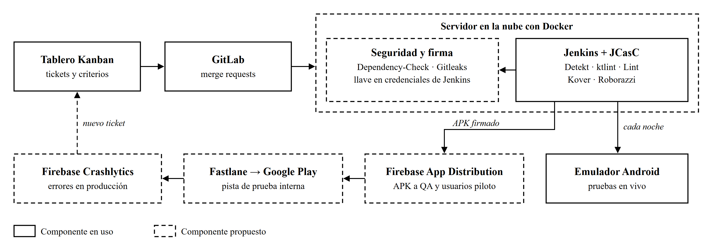

# Documentación técnica: pipelines de CI/CD del catálogo de cursos

**Actividad 3. Laboratorio técnico (Unidad 2) · Fundamentos DevOps**

## 1. Objetivo

Configurar dos pipelines para una aplicación web alojada en GitHub, como primera fase del proyecto del curso:

- **Integración continua (CI) con GitHub Actions:** compilar, probar y validar el código en cada push o pull request.
- **Entrega continua (CD) con Jenkins:** clonar el repositorio, construir una imagen Docker y publicarla en un registro de imágenes (Docker Hub o un registro local), de modo que quede disponible para su despliegue en cualquier entorno.

## 2. Relación con las actividades anteriores del curso

Este laboratorio corresponde a la primera fase del proyecto del curso, desarrollado bajo la metodología de aprendizaje basado en proyectos. Las fases siguientes incorporan el despliegue en Kubernetes con controles de seguridad y, posteriormente, el monitoreo de la aplicación.

**Actividad 1 (foro de debate).** La comparación de herramientas de CI/CD concluyó que el factor determinante no es la herramienta, sino que el pipeline esté definido como código, versionado y disponible para revisión del equipo. El laboratorio aplica ese criterio con las dos herramientas analizadas: GitHub Actions para la integración continua y Jenkins con JCasC para la entrega continua.

### 2.1 Propuesta de la Actividad 2

En la Actividad 2 (trabajo grupal) se diseñó una arquitectura de herramientas DevOps para la aplicación móvil de una plataforma educativa, desarrollada con Kotlin Multiplatform y alojada en GitLab. El punto de partida era una integración continua funcional en Jenkins, ejecutado en Docker y gestionado con JCasC, con análisis estático y pruebas automatizadas en cada rama.

El diagnóstico identificó cinco brechas:

1. Distribución manual de los artefactos a QA y a los usuarios piloto.
2. Ausencia de despliegue continuo hacia las tiendas de aplicaciones.
3. Falta de observabilidad en producción.
4. Ausencia de controles automáticos de seguridad sobre dependencias y credenciales.
5. Dependencia de un computador local para ejecutar Jenkins.

Para cerrarlas, la propuesta incorporó OWASP Dependency-Check y Gitleaks, credenciales cifradas en Jenkins, Firebase App Distribution, Fastlane, Firebase Crashlytics y la migración de Jenkins a un servidor en la nube, en una adopción gradual de cuatro fases.

*Arquitectura propuesta en la Actividad 2. Los bloques con trazo continuo representan componentes en uso y los de trazo discontinuo, componentes propuestos.*

### 2.2 Correspondencia con el laboratorio

El proyecto del curso exige una aplicación web alojada en GitHub que en las fases siguientes se desplegará en Kubernetes. Por esa razón, el laboratorio no trabaja sobre la aplicación móvil, sino sobre un servicio web de referencia del mismo dominio (un catálogo de cursos), desarrollado sin código ni datos de la organización. Sobre ese servicio se aplican los mismos principios de la propuesta, y los componentes propios del entorno móvil se sustituyen por su equivalente para una aplicación web.

| Componente (Actividad 2) | Equivalente en el laboratorio | Estado |
| --- | --- | --- |
| Control de versiones: GitLab con merge requests | GitHub con pull requests; plantilla de pull request con lista de verificación. | Implementado |
| Integración continua: Jenkins en Docker con JCasC | Jenkins multibranch en Docker con JCasC (`jenkins/`) y GitHub Actions como segunda línea de validación. | Implementado |
| Calidad de código con topes (trinquete) y avisos nuevos | ESLint con tope en `ci/topes-calidad.properties` y falla ante un aviso nuevo frente a `main` (Warnings Next Generation). | Implementado |
| Pruebas automatizadas y cobertura con mínimo (Kover) | `node:test` con reportes JUnit y cobertura de líneas con mínimo del 100 %. | Implementado |
| Revisión de costos antes de compilar | `ci/revisar-costos.sh` como primera etapa de ambos pipelines. | Implementado |
| Seguridad: Gitleaks | Gitleaks sobre todo el historial en Jenkins y en GitHub Actions. | Implementado |
| Seguridad: revisión de dependencias (OWASP Dependency-Check) | `npm audit` de dependencias de producción y Dependabot; OWASP Dependency-Check requiere una clave de la API del NVD. | Parcial; fase 2 |
| Gestión de credenciales fuera del repositorio | Secretos en el Administrador de credenciales de Windows (DPAPI) y credencial cifrada en Jenkins; usuarios `admin` y `lector`. | Implementado |
| Entrega continua a QA: Firebase App Distribution | Publicación de la imagen versionada en un registro (Docker Hub o local). | Implementado |
| Trazabilidad entre commit, compilación y versión | Etiquetas `1.0.<n>` y `<rama>-<commit>-<n>`, etiquetas OCI y `/health` con versión y commit. | Implementado |
| Resumen de cada ejecución | Página Resumen con veredicto, qué arreglar y calidad frente a los topes, más una línea por ejecución. | Implementado |
| Avisos ante fallas | Avisos de Windows cuando una rama o las pruebas en vivo fallan o se arreglan. | Implementado |
| Pruebas nocturnas en emulador | Job `pruebas-en-vivo` cada noche contra la última imagen publicada; prueba de humo en cada ejecución. | Implementado |
| Publicación en tiendas con aprobación explícita | Stage `Desplegar` con aprobación (`input`); la aplicación al clúster se agrega en la fase 2. | Parcial; fase 2 |
| Monitoreo: Firebase Crashlytics | Métricas y alertas sobre `/health` y el comportamiento del servicio. | Fase 3 |
| Planeación: tablero Kanban y tickets con criterios | Plantilla de historia de usuario con criterios de aceptación en GitHub Issues. | Implementado |

La firma del APK y la distribución por tiendas son propias de la aplicación móvil; en el servicio web, su función la cumplen la publicación de la imagen y el despliegue en Kubernetes.

El laboratorio también conserva el flujo operativo definido en la Actividad 2: el cambio se desarrolla en una rama, la integración continua lo valida antes de la revisión por pares, la entrega continua construye y publica un artefacto versionado tras la fusión y, en las fases siguientes, el despliegue y el monitoreo cierran el ciclo de retroalimentación.

## 3. Aplicación

API desarrollada en Node.js 24 con Express que expone un catálogo de cursos:

| Endpoint | Respuesta |
| --- | --- |
| `GET /` | Página de inicio |
| `GET /health` | Estado de la aplicación, versión y commit de la imagen en ejecución |
| `GET /api/cursos` | Listado de cursos |
| `GET /api/cursos/:id` | Detalle de un curso, o código 404 si no existe |

## 4. Herramientas y justificación

| Herramienta | Uso | Justificación |
| --- | --- | --- |
| GitHub | Repositorio, pull requests e historias de usuario | Centraliza el código fuente, la revisión de cambios y los requerimientos. |
| GitHub Actions | CI | Está integrado al repositorio, se configura mediante un archivo YAML y no requiere infraestructura propia. |
| Jenkins (multibranch) | CI/CD por rama | Ofrece control sobre el entorno de construcción y publicación; su configuración se versiona con JCasC. |
| Warnings Next Generation y JUnit | Topes de calidad y resultados | Aplican los topes, distinguen avisos nuevos de los existentes y muestran tendencias. |
| Docker | Empaquetado y herramientas | Garantiza que la aplicación y las herramientas se ejecuten igual en cualquier entorno. |
| Docker Hub o Docker Registry (`registry:2`) | Registro de imágenes | Docker Hub es público; el registro local implementa el mismo protocolo sin depender de una cuenta externa. |
| ESLint | Análisis estático | Identifica errores y malas prácticas antes de la ejecución del código. |
| `node:test` | Pruebas y cobertura | Ejecutor nativo de Node.js con reportes JUnit y LCOV; no incorpora dependencias adicionales. |
| Gitleaks | Seguridad | Detecta secretos en todo el historial de Git. |
| `npm audit` y Dependabot | Seguridad | Identifican vulnerabilidades conocidas y proponen actualizaciones de dependencias. |
| Administrador de credenciales de Windows | Secretos | Cifra los secretos con DPAPI, fuera del repositorio y de los archivos de configuración. |

## 5. Pipeline de CI: GitHub Actions

Archivo: `.github/workflows/ci.yml`. Se ejecuta en cada `push` (en todas las ramas) y en cada `pull_request`, con las mismas reglas que Jenkins:

1. **Checkout del código** con el historial completo (`fetch-depth: 0`).
2. **Revisión de costos** (`ci/revisar-costos.sh`).
3. **Secretos en el historial** con Gitleaks.
4. **Configuración de Node.js 24**, con caché de npm.
5. **Instalación de dependencias** con `npm ci`.
6. **Análisis estático** con ESLint.
7. **Pruebas y cobertura**, con el mínimo de `ci/topes-calidad.properties`.
8. **Auditoría de dependencias** con `npm audit --audit-level=high`.
9. **Verificación de la construcción de la imagen Docker.**
10. **Reportes** (JUnit, LCOV, ESLint y Gitleaks) guardados como artefacto de la ejecución.

Si alguno de los pasos falla, el commit o el pull request se marca como fallido en GitHub y su autor recibe la notificación.

## 6. Pipeline de CI/CD: Jenkins

Archivo: `Jenkinsfile`, ejecutado por el job multibranch `catalogo-cursos` para cada rama con commits nuevos. Todas las ramas se validan, se construyen y se prueban; solo `main` publica la imagen.

| Stage | Descripción | Frena la ejecución si… |
| --- | --- | --- |
| Revisar costos | Plugins aprobados, sin agentes en la nube, Jenkins solo en `127.0.0.1` e imágenes base esperadas. | Aparece algo que pueda generar costos o exponer Jenkins. |
| Instalar dependencias | `npm ci` en un contenedor de Node.js 24 que comparte el workspace (`ci/en-node.sh`). | Falla la instalación. |
| Calidad y seguridad (en paralelo) | ESLint, Gitleaks sobre el historial y `npm audit` de las dependencias de producción. | Hay secretos o vulnerabilidades altas; los avisos de ESLint se evalúan contra su tope. |
| Pruebas y cobertura | `node:test` con reportes JUnit y LCOV; `ci/revisar-cobertura.js` compara con el mínimo. | Falla una prueba o la cobertura baja del mínimo. |
| Construir imagen Docker | Imagen con versión, commit y etiquetas OCI. | Falla la construcción. |
| Prueba de humo | Arranca la imagen y comprueba `/health` (versión y commit esperados) y `/api/cursos`. | La imagen no responde como se espera. |
| Publicar imagen en el registro | Solo `main`: etiquetas `1.0.<n>`, `<rama>-<commit>-<n>` y `latest`. | Falla la publicación. |
| Desplegar | Solo `main` con el parámetro `DESPLEGAR`: solicita una aprobación explícita. | No se aprueba. |

Al finalizar, Jenkins registra los avisos de ESLint y de Gitleaks con sus quality gates, publica la página Resumen, archiva los reportes y cierra la sesión del registro.

### Topes de calidad

Los topes de `ci/topes-calidad.properties` (0 avisos de ESLint y 100 % de cobertura de líneas) funcionan como un trinquete: la ejecución falla si un número empeora y, cuando un cambio lo mejora, el tope se ajusta en el mismo commit. Además, cada rama se compara con la última ejecución de `main` (`discoverReferenceBuild`) y falla con un solo aviso nuevo, aunque el total siga dentro del tope.

### Página Resumen

Cada ejecución publica la pestaña Resumen (`ci/resumen/generar.js`) con el veredicto, la lista de qué arreglar y la calidad frente a los topes, y deja una línea por ejecución en la lista del job, por ejemplo `4284927 · Imagen publicada en el registro · 5 pruebas · 100,0 %`.

### Pruebas en vivo

El job `pruebas-en-vivo` (`ci/PruebasEnVivo.Jenkinsfile`) se ejecuta cada noche y a demanda: descarga la última imagen publicada, la arranca y ejecuta contra ella las pruebas de `test/en-vivo/`. La descripción de cada ejecución registra la versión y el commit de la imagen probada.

### Dockerfile multietapa

- **`test`:** instala todas las dependencias y ejecuta el análisis estático y las pruebas, de modo que el código puede validarse con Docker como único requisito.
- **`runtime`:** imagen final, con dependencias de producción únicamente, ejecutada con el usuario `node` (sin privilegios de root), con la versión y el commit como variables y etiquetas OCI, y un `HEALTHCHECK` sobre `/health`.

### Jenkins como código, secretos y avisos

- `Dockerfile` y `plugins.txt`: imagen oficial de Jenkins con el cliente de Docker y los plugins aprobados.
- `casc.yaml`: usuarios `admin` y `lector` con permisos por usuario (`matrix-auth`), credencial de Docker Hub y los jobs `catalogo-cursos` (multibranch) y `pruebas-en-vivo`, generados con Job DSL.
- `docker-compose.yml`: Jenkins y el registro local publicados solo en `127.0.0.1`, con un nombre de proyecto propio (`lab-cicd`).
- `secretos/` y `arrancar-jenkins.ps1`: los secretos se guardan en el Administrador de credenciales de Windows y se entregan a Docker Compose solo en memoria.
- `avisos/`: tarea programada que muestra un aviso de Windows cuando una ejecución falla o se arregla.

## 7. Evidencias

| Evidencia | Archivo |
| --- | --- |
| Ejecución del pipeline de CI en GitHub Actions | `docs/capturas/github-actions.png` |
| Vista de stages del pipeline en Jenkins (`main`) | `docs/capturas/jenkins.png` |
| Página Resumen de una ejecución exitosa | `docs/capturas/resumen-exito.png` |
| Página Resumen de una ejecución que falla por los topes | `docs/capturas/resumen-fallo.png` |
| Pruebas en vivo sobre la imagen publicada | `docs/capturas/pruebas-en-vivo.png` |
| Imagen publicada en el registro | `docs/capturas/registro-local.png` |

## 8. Próximas fases del proyecto

| Fase del curso | Alcance | Continuidad con la Actividad 2 |
| --- | --- | --- |
| Fase 2: Kubernetes y seguridad | Manifiestos de Kubernetes aplicados desde el stage `Desplegar`, que ya exige aprobación; análisis de la imagen (por ejemplo, Trivy) y OWASP Dependency-Check con clave de la API del NVD. | Completa la seguridad propuesta y el paso controlado a producción. |
| Fase 3: monitoreo | Métricas y alertas sobre el endpoint `/health` y el comportamiento del servicio en el clúster. | Equivale, para el servicio web, al monitoreo propuesto con Firebase Crashlytics. |
